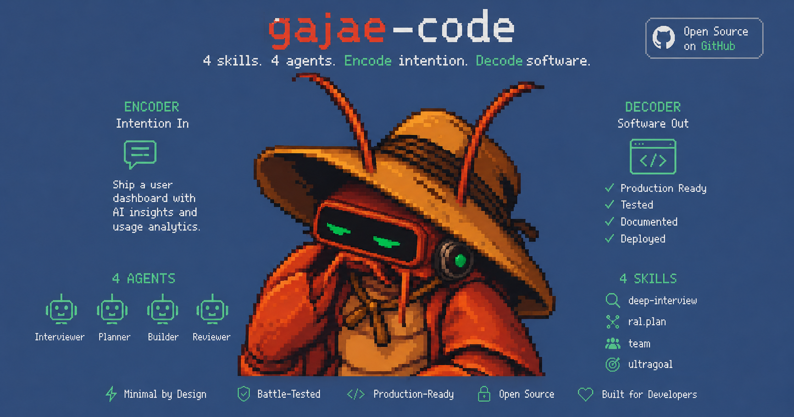
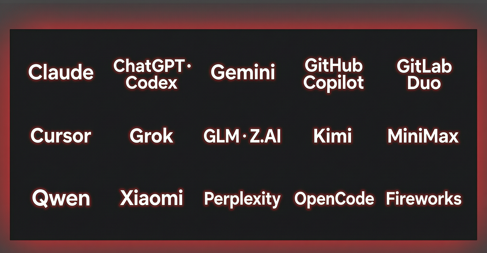

<p align="right">
  <a href="README.md">English</a> | <a href="README.ko.md">한국어</a> | <strong>中文</strong> | <a href="README.ja.md">日本語</a>
</p>

<p align="center">
  
</p>

<h1 align="center">G A J A E - C O D E</h1>

<p align="center">
  <strong>Encode intention. Decode software.</strong>
  <br/>
  <sub>可连接<strong>你已有的编程订阅</strong>、还能通过手机回复的编码代理。</sub>
</p>

<p align="center">
  <a href="https://gajae-code.com"></a>
  <a href="https://www.npmjs.com/package/gajae-code"></a>
  <a href="LICENSE"></a>
  <a href="https://discord.gg/wSyUQYfhAw"></a>
</p>

<p align="center">
  <a href="https://github.com/devswha/gajae-code-app"><kbd><strong>🖥️ 探索 Gajae-Code App → 桌面端与自托管 Web GUI</strong></kbd></a>
  <br/>
  <sub>这是由社区构建的实验性第三方项目，并非 Gajae-Code 官方第一方应用。</sub>
</p>

<p align="center">
  <a href="#快速开始">快速开始</a> ·
  <a href="#为什么选-gajae-code">为什么</a> ·
  <a href="#带上你的编程订阅">编程订阅</a> ·
  <a href="#用手机回复">手机</a> ·
  <a href="#先计划后修改">工作流</a> ·
  <a href="#花更少的-token">Token 瘦身</a> ·
  <a href="#让-openclaw--hermes-驱动-gjc">控制器</a> ·
  <a href="#文档">文档</a>
</p>

**可先澄清需求、制定并审批计划，再按证据执行 — 代理的提问可在终端、手机或你自己的 bot 上回复。**

Gajae-Code（`gjc`）是一个外置编码代理 harness，可在任意仓库或 worktree 中运行。使用支持的订阅登录时，费用按对应服务的订阅及限额计算；选择按量计费的 API 提供商时，仍会产生相应费用。不用守在终端前。

> Gajae-Code 是实验性的 beta 阶段项目。可能存在粗糙之处，重要工作请先验证输出再依赖。
>
> 本文档是英文 [README.md](README.md) 的译本。若内容有出入，以英文版为准（SSOT）。

---

## 为什么选 Gajae-Code？

大多数编码代理在三个地方翻车：向你收两次钱、没搞懂就改代码、你一离开键盘就沉默。

| 问题 | 后果 | Gajae-Code 的解法 |
| :--- | :--- | :--- |
| 订阅费与按量 API 费用叠加 | 订阅费*加上*按 token 的 API 费用 | 可登录已支持的编程订阅；若选择按量计费的 API 提供商，仍按该服务规则收费 |
| 上来就改代码的代理 | 没搞懂就动手，你来返工 | 使用计划工作流时，可先访谈、制定并评审计划，再通过审批门执行 |
| 绑死终端的会话 | 凌晨两点代理提问，工作停到早上 | 配置通知后可将提问路由到 Telegram/Discord/Slack 并远程回复 |
| 上下文膨胀 | 整文件读取和日志洪水烧掉窗口 | 可解析代码的结构化摘要、原文成功保存时的 artifact 溢出、缓存感知路由与有损压缩 |

---

## 快速开始

**安装** — 提供 Linux（x64/arm64，仅 glibc；musl/Alpine 不支持）、macOS（arm64/x64）、Windows（x64）预编译二进制。不需要 Bun：

```sh
curl -fsSL https://raw.githubusercontent.com/Yeachan-Heo/gajae-code/v0.15.3/scripts/install.sh -o gjc-install.sh
sh gjc-install.sh
gjc
```

从 `main` 管道执行会运行可变安装脚本。仅在需要最新安装器时使用。

Windows（PowerShell，固定标签）：

```powershell
Invoke-WebRequest -UseBasicParsing https://raw.githubusercontent.com/Yeachan-Heo/gajae-code/v0.15.3/scripts/install.ps1 -OutFile gjc-install.ps1
powershell -File gjc-install.ps1
```

**首次使用** — 选好订阅就出发：

```text
/login                       选择提供商 / 编程订阅
/skill:deep-interview <模糊需求>
/skill:ralplan <已澄清的需求>
/skill:ultragoal <已批准的计划>
```

`ralplan` 的最终计划须经过审批，或由已配置且有效的自动交接准入，之后才能执行。命令行 `gjc ultragoal create-goals --brief-file <path>` 只创建持久化目标，本身不会启动执行。

**运行模式：**

```sh
gjc                                # 在当前 checkout 中运行
gjc --tmux                         # 在新的 tmux 会话中启动
gjc --tmux --worktree my-task      # 高风险工作用隔离 worktree
gjc @screenshot.png "该改什么？"      # 图片输入
```

Nightly 渠道：`sh gjc-install.sh --channel nightly`（使用上面下载的 tagged 安装器）。完整安装矩阵、Windows 设置、更新渠道与 shell 补全：[docs/install.md](docs/install.md)。Bun 仅用于从源码构建。

---

## 带上你的编程订阅

<p align="center">
  
</p>

登录一次，GJC 就跑在你已经付费的订阅上。在会话内运行 `/login` 并选择你的订阅：

| 订阅 / 计划 | `/login` provider ID |
| :--- | :--- |
| Claude Pro / Max | `anthropic` |
| ChatGPT Plus / Pro（Codex） | `openai-codex`（浏览器）· `openai-codex-device`（无头） |
| Cursor | `cursor` |
| GitHub Copilot | `github-copilot` |
| OpenCode Zen / OpenCode Go | `opencode-zen` · `opencode-go` |
| Kimi Code / Coding Plan / Moonshot | `kimi-code` · `moonshot` |
| Z.AI GLM Coding Plan | `zai` |
| MiniMax Coding Plan（国际 / 国内） | `minimax-code` · `minimax-code-cn` |
| xAI（Grok） | `xai` |
| 阿里 Token Plan / Qwen Portal | `alibaba-token-plan` · `qwen-portal` |

表中的 ID 是 `/login` 登录入口，并不表示认证方式都是 OAuth；不同服务可能使用浏览器/设备授权或 API key。

其他可用的订阅与服务入口还包括 Google Gemini CLI、Google Antigravity、GitLab Duo、Perplexity Pro/Max、Fire Pass 和小米 Token Plan；认证方式因服务而异，详见 [docs/models.md](docs/models.md)。

### 编程订阅预设

基于 API key 的编程订阅可用一条命令写入对应的模型配置。`setup provider --preset` 不存储或验证实际凭据；下列 GOAT 与 ClinePass 预设配置了运行时目录发现，目录更新后无需升级 GJC 即可获取新增模型：

```sh
gjc setup provider --preset commandcode-goat   # Command Code GOAT 订阅（CMD_API_KEY）
gjc setup provider --preset cline-pass         # ClinePass（CLINE_API_KEY）
```

- **Command Code GOAT** — 从提供商的 `/provider/v1/models` 端点发现模型；Claude 模型 ID（包括 `anthropic/claude…`）走原生 Anthropic Messages，其余走 Chat Completions。别名：`commandcode`、`command-code`、`goat`。
- **ClinePass** — 不硬编码模型；GJC 从 `models.dev` 上游目录获取 ClinePass 模型列表（不是调用 Cline 的 `/models` 端点）。别名：`clinepass`、`cline`。
- 其他可用预设：`minimax`、`minimax-cn`、`glm`、`alibaba-token-plan` — 或在 TUI 中使用 `/provider add --preset <name>`。

<details>
<summary><strong>编程订阅之外：50+ 提供商、网关、本地运行时</strong></summary>

API key 提供商、本地运行时（Ollama、LM Studio、vLLM）与网关（Cloudflare AI Gateway、Vercel AI Gateway、LiteLLM 等）全部可用。在 `models.yml` 注册自有端点，按用量在每个提供商的多账户间路由，用模型预设/配置按代理角色混搭厂商，或用 auth broker/gateway 集中管理团队凭据。

- [模型、提供商与认证解析](docs/models.md)
- [自定义提供商与多账户路由](docs/custom-providers-and-multi-account.md)
- [多厂商角色配置](docs/multi-vendor-profiles.md)
- [Auth broker 与 gateway（团队共享凭据）](docs/auth-broker-gateway.md)

</details>

---

## 用手机回复

<p align="center">
  
</p>

启用并配置 Telegram 通知后，代理需要决策时可 ping 你的 Telegram — 你在任何地方都能回复：

- **仅协调器/生命周期会话使用论坛话题**：可接收实时/最终输出、上下文更新、图片附件、内联按钮、自由文本回复和输入中指示；普通会话使用扁平消息投递。
- **一次配置**：在运行中会话的 `/settings` → Notifications，或无头方式 `gjc notify setup|status|health|test|recovery`。令牌输入即打码，之后永不显示。
- **`gjc daemon`** 让共享本地 agent 目录和 bot/聊天配置的会话复用现有 long-poll 所有者；其他 GJC 配置目录、主机或程序若也在轮询同一令牌，仍可能发生 Telegram 409 冲突。
- Discord 与 Slack 也提供托管投递；自建 bot 或移动客户端可接入通用 `action_needed`/`reply` 协议路由回答，无需抓取终端。

[Telegram 上手](docs/telegram-onboarding.md) · [Discord](docs/discord-onboarding.md) · [Slack](docs/slack-onboarding.md)

---

## 先计划，后修改

刻意收窄的工作流表面 — 四个技能、四个角色代理，仅此而已：

```text
deep-interview -> ralplan -> ultragoal
               └─ 研究必须为计划奠基时可选 autoresearch 任务
```

| 表面 | 作用 |
| :--- | :--- |
| `deep-interview` | 把模糊请求变成具体需求。 |
| `ralplan` | 在改代码之前制定并评审实现计划。 |
| `ultragoal` | 跟踪目标贯穿执行、修订、验证与证据。 |
| `autoresearch` | 执行目标导向的研究任务，并以结构化结论收尾。 |
| `executor` / `architect` / `planner` / `critic` | 内置角色代理，覆盖实现与只读评审通道。 |

**`computer` 桌面控制工具**仅在 Apple Silicon macOS 上默认可用；每次执行仍受 supervisor 与 macOS 屏幕录制/辅助功能权限约束，设置 `computer.enabled=false` 可禁用。另见 [Python REPL](docs/python-repl.md) 与 [computer 工具文档](docs/tools/computer.md)。

---

## 花更少的 token

GJC 同时优化 token 账单的两端：

- **缓存复用** — 缓存保留由提供商的 `cacheRetention` 控制；标准 Anthropic 端点默认使用长效缓存（支持时最长 1 小时），兼容网关的实际保留时间取决于其配置与能力。模型解析先遵循提供商优先级、凭据和能力等规则，再将输入与 `cacheRead` 成本纳入排序；可选的 session-affinity 请求头可帮助兼容中继复用服务端提示缓存，但不保证命中。
- **上下文管理** — 可解析代码文件通常以结构化摘要呈现，其他文件内容会受范围限制；超大 shell 输出会被缩减，只有在原始内容成功保存时才附带可用的 `artifact://` 引用。压缩与分支摘要帮助长会话保留关键上下文，但摘要可能省略细节。

[缓存保留与提供商兼容](docs/models.md) · [压缩与分支摘要](docs/compaction.md)

---

## 让 OpenClaw / Hermes 驱动 GJC

GJC 内置原生 Coordinator MCP 桥，OpenClaw 或 Hermes 等外部控制器通过持久 turn 编排真实的 GJC 会话 — 绝不抓取终端。

把这段提示词粘贴进 OpenClaw、Hermes 或其他 MCP 控制器，让它按对应宿主配置接入：

<details>
<summary><strong>复制粘贴的控制器配置提示词</strong></summary>

```text
Set up Gajae-Code (gjc) as your coding-agent backend on this machine. gjc is already installed.

1. If the controller accepts a Hermes-compatible MCP profile, render and install the setup package (replace the paths):
   gjc setup hermes --root <ABS_REPO_PATH> --profile <PROFILE_NAME> --repo <REPO_NAME> \
     --mutation sessions,questions,reports --profile-dir <YOUR_PROFILE_DIR> --install
   For a render-only preview, omit both --install and --profile-dir/--target.
   Installation requires --install plus --profile-dir or --target.
   If the host uses another config format, skip this profile-specific step and register the coordinator directly in that host.

2. Verify the coordinator contract (non-mutating, no LLM call):
   gjc mcp-serve coordinator --check --json
   To check installed profile files, reuse the installation's values:
   gjc setup hermes --root <ABS_REPO_PATH> --profile <PROFILE_NAME> --repo <REPO_NAME> \
     --mutation sessions,questions,reports --profile-dir <YOUR_PROFILE_DIR> --check
   A separate in-memory tool-catalog smoke (not an installed-file check) is:
   gjc setup hermes --root <ABS_REPO_PATH> --smoke
   Do not combine --check and --smoke.

3. Register the MCP server in the controller config (when using the generated profile, use its installed config). It is equivalent to:
   command: gjc, args: ["mcp-serve", "coordinator"]
   env: GJC_COORDINATOR_MCP_WORKDIR_ROOTS=<ABS_REPO_PATH>,
        GJC_COORDINATOR_MCP_PROFILE=<PROFILE_NAME>,
        GJC_COORDINATOR_MCP_REPO=<REPO_NAME>,
        GJC_COORDINATOR_MCP_SESSION_COMMAND="gjc --worktree",
        GJC_COORDINATOR_MCP_MUTATIONS=sessions,questions,reports

4. To delegate coding work, prefer one call per workflow:
   gjc_delegate_plan / gjc_delegate_execute
   with { cwd, task, worktree: <unique-name>, allow_mutation: true, idempotency_key: <unique-key> }.
   Each starts or reuses a session and returns a durable turn_id and artifact references.
   New sessions use GJC-managed worktrees by default; give concurrent tasks different worktree names.
   Reusing session_id does not create a new worktree.

5. For finer control: gjc_coordinator_start_session -> gjc_coordinator_send_prompt ->
   poll gjc_coordinator_read_turn or bounded gjc_coordinator_await_turn; while a turn waits for an answer,
   answer gjc_coordinator_list_questions rows via gjc_coordinator_submit_question_answer, then resume polling.
   After the turn is terminal, optionally record controller-authored status with gjc_coordinator_report_status;
   stop an ephemeral session with gjc_coordinator_stop_session only when appropriate.

Rules: each mutation needs allow_mutation: true. For tools advertising idempotency_key,
each distinct request needs a unique key; stop_session does not accept that field.
The server must also enable that mutation class; obtain user approval before allowing changes.
Reuse a key only to retry the identical request; use a new key if its arguments change.
Treat durable turn state as authoritative; never scrape terminal output.
The session command selector accepts only "gjc" or "gjc --worktree [name]".
```

</details>

若控制器要操作在线会话，可使用经 Broker 绑定的 `gjc sdk session` CLI（`list|inspect|send|status|tail|close|retire`）以及内置 `sdk-skills/`（`gjc-sdk-discover` · `gjc-sdk-operate` · `gjc-sdk-author`）。机器调用请显式附加 `--json`，以便从结构化错误中读取结果；否则普通错误会写到 stderr。外部控制器应通过这些受支持的接口操作；会话端点凭据和原始 WebSocket 并非公共接入接口。面向可信本地脚本的 `gjc-sdk-operate` 技能要求每项变更都经一次性人工确认。

- [外部控制器集成指南](docs/bot-integration.md) · [Coordinator MCP 桥](docs/hermes-mcp-bridge.md)
- [外部控制器 / 机器人](docs/bot-integration.md) — 提供商无关冒烟测试；[`docs/aside-integration.md`](docs/aside-integration.md) 涵盖可选的搜索/上下文边车和 `/aside` 编辑器命令
- [SDK 与线协议](docs/sdk.md) · [SDK 会话 CLI](docs/sdk-session-cli.md) · [外部控制就绪度](docs/external-control-readiness.md)

---

## 文档

从 **[gajae-code.com](https://gajae-code.com)** 或 `docs/` 开始：

- [安装与更新](docs/install.md) · [环境变量](docs/environment-variables.md) · [快捷键](docs/keybindings.md) · [主题](docs/theme.md)
- [模型与提供商](docs/models.md) · [自定义提供商与多账户路由](docs/custom-providers-and-multi-account.md) · [多厂商配置](docs/multi-vendor-profiles.md) · [Auth broker](docs/auth-broker-gateway.md)
- [Telegram](docs/telegram-onboarding.md) · [Bot 集成](docs/bot-integration.md) · [SDK](docs/sdk.md) · [SDK 会话 CLI](docs/sdk-session-cli.md)
- [会话](docs/session.md) · [压缩](docs/compaction.md) · [记忆](docs/memory.md) · [密钥](docs/secrets.md)
- [代码库概览](docs/codebase-overview.md) · [贡献 / 开发环境](CONTRIBUTING.md)
- [macOS Option/Alt 键设置（iTerm2）](docs/macos-option-key.md) · [GEO 可见性基准](docs/geobench.md)

默认深色 TUI 标识是 GJC red-claw 主题；浅色外观终端默认使用内置 blue-crab 主题。换主题或自建主题见[主题](docs/theme.md)。

## SDK 扩展

- [gjc-remote](https://github.com/kogangdon/gjc-remote) — 从 Discord 控制远程主机上白名单内的 GJC 会话。
- [oh-my-gajae-code](https://github.com/devswha/oh-my-gajae-code) — 提供额外技能与斜杠命令的社区插件市场。
- [GJC 多厂商配置指南](https://github.com/project820/gjc-multivendor-setup-guide) — 面向多厂商配置的角色化提供商方案。

## 开发

```sh
bun install
bun run build:native
bun run dev:link       # 全局 `gjc` 运行本 checkout 的源码
bun run dev:doctor     # 验证链接
```

包结构图与门禁见 [CONTRIBUTING.md](CONTRIBUTING.md) 与 [docs/codebase-overview.md](docs/codebase-overview.md)。

## 贡献者与谱系

感谢 [Yeachan-Heo](https://github.com/Yeachan-Heo)、[IYENTeam](https://github.com/IYENTeam)、[HaD0Yun](https://github.com/HaD0Yun) 和 [probepark](https://github.com/probepark)。GJC 建立在一小族代理 harness 的经验之上；历史归属见 [NOTICE.md](NOTICE.md)。

## 许可证

MIT。见 [LICENSE](LICENSE)。

---

<p align="center">
  <em>"Encode intention. Decode software."</em>
  <br/><br/>
  <strong>计划在前。修改要自己挣得位置。</strong>
</p>
